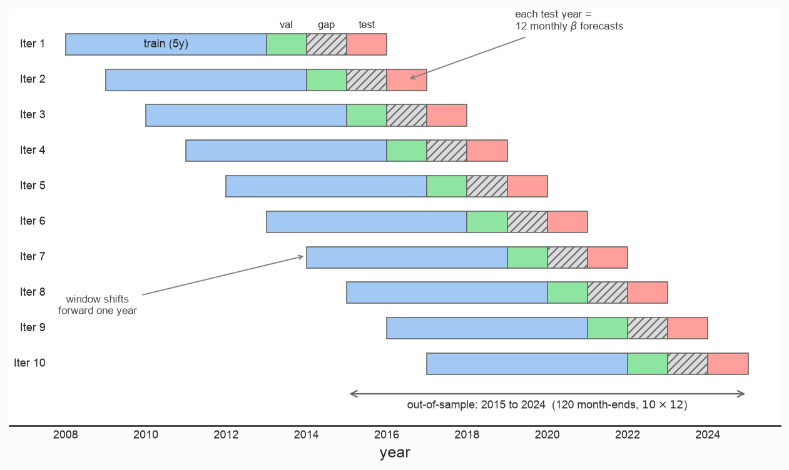
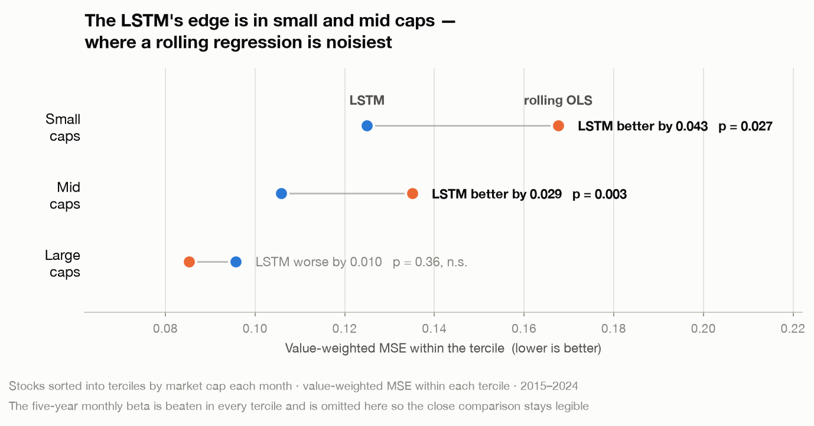

# Forecasting Stock Betas with an LSTM (SET100)

[](https://github.com/isara-kh/set100-beta-lstm/actions/workflows/tests.yml)

Can a neural network predict a stock's **future market beta** better than the
rolling regressions the industry has used for decades? This project builds a
walk-forward **LSTM** that forecasts the one-year-ahead beta of Thai SET100
stocks out-of-sample, and grades it against the two classic rolling-OLS
estimators with Diebold–Mariano tests.

> **Beta** measures how much a stock moves with the market — the key input to
> the cost of equity (CAPM), portfolio hedging, and risk budgeting. The catch:
> the beta you *want* is next year's, but all you can measure is the past. This
> repo treats "next year's beta" as a supervised-learning target and forecasts
> it.

*Originally an Independent Study at Chulalongkorn Business School. The
manuscript is not publicly deposited; available on request. This repository is
the work reorganised as a standalone project — the code, the walkthrough, and
the evidence.*

## How the forecasts are made

Every forecast is made from past data only. The model is refit once a year on a
rolling five-year window, and a **full year is discarded** between the
validation and test blocks — the same length as the forecast horizon, so a
validation label's twelve-month realization window can never overlap the test
period. Ten refits tile the 2015–2024 out-of-sample decade.



## Headline result

Out-of-sample, 2015–2024 (120 months, 10,145 stock-month forecasts), scored on
**value-weighted MSE** — market-cap weighted, so large stocks count more, the
way a portfolio actually holds them.

Cumulating the monthly loss difference against each benchmark shows the two
results at once: a steady, decisive win over the five-year monthly beta, and no
durable edge over the one-year daily beta.


| Model | What it is | VW-MSE | vs LSTM |
|---|---|---:|---:|
| **LSTM** | 8-unit network over a 12-month lookback of 10 predictors | **0.0995** | — |
| OLS&nbsp;1Y&nbsp;daily | 1 year of daily returns, rolling OLS beta | 0.0974 | −0.0021 |
| OLS&nbsp;5Y&nbsp;monthly | 5 years of monthly returns, rolling OLS beta | 0.1968 | +0.0973 |

The LSTM **matches** the strong short-window daily estimator (DM *t* = 0.20, not
significant) and **decisively beats** the long-window monthly one
(**DM *t* = −6.55, p < 0.001**). That second result is the practically useful
one: the five-year monthly beta is still widely quoted, and it is worse by a
factor of two.

### Where the accuracy actually comes from

The aggregate above hides the more interesting finding. Sorting stocks into size
terciles each month — and keeping the same value-weighted loss *within* each
tercile — the LSTM's advantage is concentrated in smaller names:



| Size tercile | LSTM | OLS 1Y daily | OLS 5Y monthly | DM vs 1Y daily | p |
|---|---:|---:|---:|---:|---:|
| Small | **0.1250** | 0.1676 | 0.3600 | −2.21 | **0.027** |
| Mid | **0.1058** | 0.1350 | 0.2254 | −3.00 | **0.003** |
| Large | 0.0957 | **0.0852** | 0.1797 | +0.92 | 0.360 |

The LSTM **significantly beats** the rolling-OLS beta in small and mid caps,
where a one-year daily regression is noisiest, and loses — insignificantly — only
in large caps. Because the headline metric is value-weighted, the large tercile
dominates it, so the aggregate "tie" is partly an artefact of the weighting.

This is a full-sample cut. How the size advantage behaves across the pre- and
post-COVID regimes is broken out in
[notebook 03](notebooks/03_oos_forecast_plots.ipynb), and reproduces with
`python -m betaforecast.importance.subsamples --dm-only`.

A zero-out importance test shows the forecast leans on **recent rolling betas**
(`OLS_3M_D` *t* = 4.93, `OLS_1Y_D` *t* = 3.58); firm characteristics add little.

## Approach

```
 raw SET100 data ──► panel of (stock, month): target + 10 predictors
                          │
                          ▼
        12-month lookback sequences  (strict, gap-free, no look-ahead)
                          │
                          ▼
     walk-forward LSTM ensemble  (10 rolling refits × 10 random seeds)
                          │
                          ▼
   out-of-sample forecasts ──► value-weighted MSE + Diebold–Mariano tests
```

Design choices that make the horse race fair:

- **Forward realized-beta target** — the beta actually realized over the *next*
  12 months, so the model is graded on the future, not the past.
- **Value-weighted loss and metric** — training and evaluation both weight each
  stock by market cap, matching how the forecast would be used.
- **Walk-forward with a gap year** — the model is refit each year on past data
  only; a one-year buffer between the validation and test windows removes the
  overlap the 12-month horizon would otherwise create, so early stopping carries
  no look-ahead.
- **Seed ensemble** — 10 random initialisations averaged, to cancel the noise of
  any single unlucky fit.
- **Honest significance test** — Diebold–Mariano with a Newey–West HAC standard
  error at lag 11, because 12-month-ahead errors overlap by construction.

## What you can run

The out-of-sample forecast table ships with the repo — it holds only derived
statistics — so every number above reproduces from a bare clone in seconds:

```bash
uv sync
uv run python -m betaforecast.evaluation.evaluate            # the VW-MSE table
uv run python -m betaforecast.evaluation.dm_test             # the DM horse race
uv run python -m betaforecast.importance.by_size             # the size terciles
uv run python -m betaforecast.importance.subsamples --dm-only  # size × regime
uv run python -m betaforecast.figures.readme_figures         # the figures above
uv run pytest                                                # leak-free invariants
```

Everything upstream of that — building the panel, training the ensemble, the
zero-out importance — needs the raw data and the trained models, which are not
distributed (see [Data availability](#data-availability)). Those steps fail with
a clear message rather than silently producing nothing.

## Read the notebooks in order

Each renders its own plots and tables:

1. **[`01_data_preparation.ipynb`](notebooks/01_data_preparation.ipynb)** — from
   raw prices and dividends to the clean stock-month panel of target + 10
   predictors.
2. **[`02_lstm_explained.ipynb`](notebooks/02_lstm_explained.ipynb)** — a code
   walkthrough of the model: lookback sequences → leak-free standardisation →
   the value-weighted walk-forward LSTM, with a runnable mini-demo.
3. **[`03_oos_forecast_plots.ipynb`](notebooks/03_oos_forecast_plots.ipynb)** —
   the out-of-sample results: forecast vs forward realized beta, value-weighted
   MSE over time, and the size × regime breakdown.

## Repository layout

```
betaforecast/               the pipeline, grouped by stage (importable package)
├── data/                   load raw inputs → build the target + 10 predictors
│   ├── sources.py          raw loaders (prices, factors, membership, ...)
│   ├── dividends.py        cash-dividend yields → total returns
│   ├── returns.py          daily / monthly total & excess returns
│   ├── predictors.py       ME, DIVPAY, TO, MOM, IVOL, ILLIQ, DFY
│   ├── panel.py            forward realized-beta target + rolling-OLS betas
│   └── build.py            end-to-end build + descriptive tables
├── features/               model-ready inputs
│   ├── sequences.py        strict 12-month lookback windows + walk-forward splits
│   └── standardize.py      per-month rank-standardisation + per-fold DFY scaling
├── model/
│   ├── lstm.py             the LSTM, value-weighted training, walk-forward driver
│   ├── tune.py             hyperparameter grid search (offline experiment)
│   └── analyze_tuning.py   summarise the tuning run
├── benchmarks.py           align the two rolling-OLS benchmarks to the OOS set
├── evaluation/
│   ├── evaluate.py         value-weighted MSE
│   └── dm_test.py          Diebold–Mariano tests (full sample + pre/post-COVID)
├── importance/             zero-out predictor importance, size/regime cuts
├── figures/                figure-generation scripts
│   └── readme_figures.py   the two result figures above
└── paths.py                one place for all filesystem paths
notebooks/                  the three-part walkthrough above
tests/                      look-ahead and weighting invariants
docs/img/                   the figures the README embeds (versioned)
docs/adr/                   architecture decision records
CONTEXT.md                  glossary — the project's vocabulary, pinned
```

## Setup

Uses [uv](https://docs.astral.sh/uv/) with a pinned, reproducible environment
(TensorFlow / Keras 3, pandas, numpy, scipy, matplotlib):

```bash
uv sync                 # install everything, incl. the notebook tooling
uv run jupyter lab      # open the notebooks
```

Full pipeline order, with raw inputs in place: `data.build` → `model.lstm` →
`benchmarks` → `evaluation.evaluate` → `evaluation.dm_test` →
`importance.zero_out` → the `figures/` scripts.

## Data availability

The raw data (Refinitiv prices, SETSMART dividends, SET100 membership) and the
trained model checkpoints are **not** distributed, for licensing and size
reasons. The code expects raw inputs under `data/raw/` and writes processed
panels and tables under `data/processed/`.

The one exception is `data/processed/oos_forecasts.parquet`, which is committed:
it contains only derived statistics — forward realized betas, the three
forecasts, log market cap, and the stock-month key — and nothing from which a
licensed price series could be reconstructed. It is what makes the evaluation
reproducible. See [ADR 0001](docs/adr/0001-ship-derived-forecasts-only.md).

## Method notes

- **Rank standardisation** — each month the nine firm/beta predictors are ranked
  cross-sectionally and mapped to [−1, 1] (following Gu, Kelly & Xiu 2020), so
  the model sees comparable, outlier-robust inputs with no look-ahead.
- **Rolling vs expanding window** — the training window rolls (5 years) rather
  than expands, following Drobetz et al. (2025); an expanding window tested
  slightly worse (VW-MSE 0.1124 vs 0.1094).
- **Benchmarks are persistence forecasts** — the rolling-OLS betas are used
  as-is as next-year forecasts, so there is no extra estimation to tune.
- **Vocabulary** — "benchmark" always means a competing *forecast*, never the
  market index; the index is the *market proxy*. The prediction target is always
  the *forward* realized beta. See [CONTEXT.md](CONTEXT.md).
