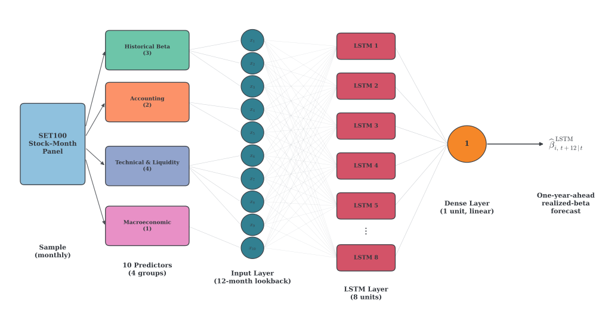

Can a neural network forecast a stock's future beta better than the rolling regressions practitioners have used for decades? Short answer: it depends on the stock.

<Stat value="~2×" caption="more accurate than the 5-year monthly beta (value-weighted MSE 0.0995 vs 0.1968, DM t = −6.55)" />

<Stat value="t = 0.20" caption="a statistical tie with the 1-year daily beta on the value-weighted aggregate" />

<Stat value="Small + mid" caption="caps are where the LSTM beats the 1-year daily beta, significantly, over 2015–2024" />

## 1. The question

Beta measures how much a stock moves with the market. It feeds the cost of equity, portfolio hedging and risk budgeting. The trouble is that the beta you want is next year's, and all you can measure is the past.

The usual fix is a rolling regression, and it carries a bias–variance trade-off. A short window reacts quickly but is noisy. A long window is stable but slow to adapt. Machine-learning forecasts have improved asset-pricing predictions in developed markets, but almost all of that evidence comes from the United States. Emerging markets are far less studied, even though they have thinner trading, more concentration in a few large stocks and more frequent regime shifts. I wanted to know whether the gains carry over to the Stock Exchange of Thailand.

## 2. Method

The target is the forward realized beta: the beta a stock actually realizes over the twelve months after the forecast origin. Writing $\beta^{R}_{i,t}$ for that quantity, the model forecasts $\beta^{R}_{i,t}$ using only information available at month $t$.

The LSTM sees a gap-free twelve-month lookback of ten predictors: three rolling betas (`OLS_3M_D`, `OLS_1Y_D`, `OLS_5Y_M`), firm size, dividend payout, turnover, momentum, idiosyncratic volatility, illiquidity and the default spread. Each forecast is the average of ten random initialisations, which cancels the noise of any single unlucky fit.

The model is refit once a year on a rolling window, and a full year is discarded between validation and test. The gap is as long as the forecast horizon, so a validation label's twelve-month window can never overlap the test period.

<Embed id="walk-forward" />

## 3. The evidence

The two benchmarks are rolling OLS betas used unchanged as forecasts: one year of daily returns, and five years of monthly returns. Over 120 out-of-sample months (2015–2024) I score every model on value-weighted MSE, so that large stocks count more, the way a portfolio holds them. Diebold–Mariano tests use a Newey–West standard error, because twelve-month-ahead errors overlap by construction.

The LSTM scores 0.0995, the 1-year daily beta 0.0974 and the 5-year monthly beta 0.1968. Against the 5-year monthly beta the LSTM wins decisively (DM t = −6.55). Against the 1-year daily beta it is a tie (t = 0.20), and the monthly differentials below show no durable edge. On the equal-weighted measure the LSTM does win against both benchmarks (10.94% against 13.55% and 26.42%, t = −2.36 and −9.73).

<Embed id="horse-race" />

## 4. Where complexity pays

The value-weighted aggregate is dominated by the largest stocks, and that is where a one-year daily regression is already hard to beat. Cutting the sample into size terciles shows the LSTM's edge sits elsewhere. In small caps its value-weighted MSE is 0.1250 against 0.1676 for the 1-year daily beta (t = −2.21). In mid caps it is 0.1058 against 0.1350 (t = −3.00). In large caps it is slightly worse, 0.0957 against 0.0852, and the difference is not significant (t = 0.91).

The small-cap edge is clearest before COVID. The grid below breaks it out by regime, and the edge fades after the onset.

<Embed id="where-it-wins" />

## 5. Why it wins there

The LSTM does not just shrink its forecasts towards the mean, as the classical Blume and Vasicek adjustments do. In the manuscript's words, its shrinkage is "nonlinear and asymmetric, rather than the linear correction of the classical models". The realized beta has a standard deviation of 0.39 and is right-skewed (skewness 0.75). The LSTM forecast has a standard deviation of 0.19 and is mildly left-skewed (skewness −0.43), because it compresses the high-beta side far more than the low-beta side.

My reading, and it is only a reading, is that a one-year daily regression already estimates large, liquid stocks with little bias, so there is little room left for a richer model. Where the return history is short or noisy, the extra flexibility pays.

<Embed id="shrinkage" />

## 6. What the model relies on

A zero-out importance test replaces one predictor at a time with its training-fold mean, reruns the saved ensemble, and measures how much the value-weighted forecast error rises. Only the recent rolling betas matter: `OLS_3M_D` (t = 4.93) and `OLS_1Y_D` (t = 3.58). The firm characteristics add little. So the network earns its edge mainly through the flexible way it recombines recent realized betas, not through extra signal from the wider predictor set.

<Embed id="importance" />

## 7. Takeaways and limits

The practical lesson is to match model complexity to the use case. For large-cap risk estimates a one-year daily rolling regression is hard to improve upon. The extra cost of an LSTM is easier to justify for small and mid caps. The five-year monthly beta, still widely quoted, is worse by a factor of two.

The limits are real. The SET100 cross-section is small, which limits the data available to train the network. The architecture is deliberately parsimonious and held fixed across refits, so richer or adaptively tuned models might extract more. The study covers a single market and a single beta definition. The small-cap edge is concentrated before the pandemic and should not be assumed to hold in every market environment.

Next I would add an economic-value test, for example minimum-variance or anomaly-hedging portfolios built on the competing beta forecasts, to see whether the statistical edge pays in practice.

Resources: the [code and README](https://github.com/isara-kh/set100-beta-lstm) and the [redacted manuscript](./attachments/manuscript-redacted.pdf).
